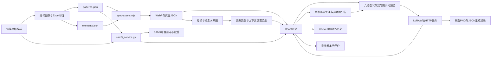

# 系统架构

## 主体优先生图策略

`generation_policy.py` 管理 `standard` 与 `subject-fidelity`。HTTP预览及生成统一读取 `generation_profile`，省略时使用 `standard`。编排器 `dong-semantic-plan-6` 在主体优先模式中保留完整主体／属性分组，按主体、构图、其他条件排序，在各类内部沿用优先级。该排序同时参与CLIP预算。启用的根主体无法采用时返回校验错误，避免仅有风格条件进入推理。

主体优先模式使用画布文本自身的主体与风格内容。`fidelity_conditioning` 根据实际采用条件和有效整图描述推导负向词，分别处理画框与边饰、重复与单体、全局方向与局部条纹。常见否定短语参与规则检查，子主体的构图不会直接升级为全局布局。负向词按完整词组进入77词元预算。`generation_policy` 保存策略版本、布局判断、保留与省略的负向词及词元数，并明确 `spatial_control=text-only`。

`generationProfile` 和 `generationPolicy` 经前端适配器进入预览、生成结果、IndexedDB历史与JSON导出。草稿保存所选profile，预览有效性key包含profile。图像模型、推理锁与逐候选文件保存由 `lora_service.py` 管理。该模式使用本机SD1.5与侗绣LoRA权重，风格强度通过LoRA适配器设置。实验与实现限制见 [改进验证](outputs/subject-fidelity-validation-2026-11-09/index.html)。

## 数据流

`纹样库/侗族/_标注成果`是规范数据源。`website/scripts/sync-assets.mjs`读取JSON和PNG，生成适合网页加载的WebP与页面JSON。生成目录可以删除并重复生成。

## 前端

路由包括：

- `/`：项目首页与流动纹谱。
- `/patterns`：80件纹样图录和多条件筛选。
- `/patterns/:id`：纹样详情与关联纹样元。
- `/dynamic`：Canvas动态纹样、暂停、参数调整与图像导出。
- `/deconstruct`：SAM3框选与候选复核。
- `/create`：知识推荐、六维语义画布、LoRA生成、候选对照及历史恢复。
- `/workshop`：参数化文创白模与等比纹理映射。
- `/museum`：Three.js展厅全景、展品近景与截图导出。
- `/evaluate`：五维评价和本地记录。

`PatternRepository`、`GenerationService`、`EvaluationRepository`和`SegmentationService`构成页面与具体实现之间的接口边界。后续接入HTTP服务时应新增适配器，尽量不改页面结构。

## SAM3服务

服务默认监听`127.0.0.1:8000`，只接受本机来源。健康接口不会加载模型；首次分割请求才加载CUDA模型。分割结果包含候选边界、质量指标、预览图和透明PNG数据。

## 本地状态

SAM3临时候选使用`sessionStorage`带入创生工坊。创作记录使用IndexedDB保存最近12轮，包含本轮参考图像快照、语义条件、候选种子及批注。评价记录使用`localStorage`保存最近20条。本地记录支持在同一浏览器中恢复。

`workshopSession.ts`统一校验文创会话和解析纹样、载体、贴图来源与排版。URL显式选择优先，损坏或不匹配的记录回退到规范母纹。`appearance`保存缩放、位置、旋转、重复、去底、物品主色与部件色，早期记录采用载体默认值。缺失的`detailColor`补为`auto`，旧方案已有排版与主色继续保留。显式使用母纹时采用URL排版或默认值，避免激活旧生成方案。

`domain.ts`的`PRODUCT_CARRIERS`统一14款载体标识与会话校验，`productCatalog.ts`维护四类产品目录，`productColors.ts`统一12种预设色、颜色解析与可配色部件名称。`productModels.ts`注册模型，`productEverydayModels.ts`构建保温杯、杯垫与书签，`productAccessoryModels.ts`构建折扇、手机壳与收纳包。`productGeometry.ts`提供曲面和细分网格，`productMaterials.ts`把原纹与主色合成到产品UV空间，部件使用独立材质。织物、釉面、纸面和木框使用各自的粗糙度与微表面贴图。贴图台复用加载的原纹和WebGL实例，连续调参合并后重建产品。展厅共享模型和材质，中央展品采用当前方案，外围按目录类别分区阶梯陈列，采用各自默认排版与展陈配色。

动态、文创和展厅路由按需加载，Three.js随三维页面加载。三维渲染实例各自释放画布、环境反射、材质、纹理和事件监听，取消后的异步加载只清理自身资源。页面隐藏时暂停绘制，流动纹谱还会在预览离屏时暂停动画。

## 知识驱动生成

`knowledge.ts` 从规范母纹JSON生成带来源的双向关系图。主视觉元素、辅助元素、构图、对称与重复、色彩、文化说明、风格技法分别保留原始字段类型。同一概念聚合时保留每件母纹的原文、来源与证据类别；聚合证据采用较审慎的等级。用户编辑后的条件与原始标注分别保存，标注来源不被视为对编辑内容的背书。

默认算法为 `context-walk-v2`。起点权重包括当前母纹3、启用概念的优先级除以匹配数量平方根、检索命中4、目标或正向意图命中2、反馈重点5除以匹配数量平方根。边权乘以已选概念优先级因子 `1+0.25p`、检索命中因子2、目标对应关系类型因子、意图命中因子2，未达到资料支持等级的文化说明再乘0.4。每个节点归一化出边权重后传播6步。游走长度均匀分布于1至6，每次游走累计转移后所有节点的访问次数，第k步权重为 `(7-k)/21`，起始节点不计入访问。悬空节点回到种子分布。`context-walk-v1` 保留各步终点概率的平均值。结果排除已选与暂不推荐概念，分数表示图相关性。

创作方向的明确权重位于 `GOAL_RELATION_WEIGHTS`；简洁与连续目标的正向种子位于 `GOAL_TERMS`。意图匹配是可解释的关键词规则，包含已列出的否定词的分句不作为正向提示，不具备通用语言理解能力。复杂意图仍由本机Qwen整理并由用户确认。论文中的上下文匹配函数未完整披露，本项目这些配置为自行设计的可复现实例。`restart-v1`保留原来的32步、0.2重启概率方案，不使用新增目标和反馈因子，供消融对照。

每条推荐保留一条真实存在的最短关联路径与来源集合；此路径用于人工追溯，并非完整的分数归因。画布增加主体关系树、四种创作方向与暂不推荐／恢复操作。推荐被采纳时，路径和原始标注随语义方案进入预览、生成、历史及JSON导出。

页面通过`GenerationService`向8001端口提交版本化`semantic_plan`。`POST /api/lora/preview`调用同一提示词编排器进行CPU预览，`POST /api/lora/generate`在实际分词器预算内复核条件后调用SD1.5与LoRA。优先级控制文本顺序和超长取舍。旧版请求字段继续由原提示词逻辑处理。

`parentId`为可选所属关系，引用已有主体并支持多层组合。编排器验证循环和悬空引用后，以`subject with attributes`组合英文子句，按整组最高优先级排序，并以整组为单位进行词元预算取舍。每个启用概念都有`concept_dispositions`记录，缺少英文、重复、主体停用及词元预算不足均有明确原因。

`dong-semantic-plan-5`保留版本1方案的向后兼容，通过可选`context`、`annotations`、`recommendation`和`promptRealization`扩展记录。`semantic_checks.py`只检查已启用且祖先有效的概念，并按`parentId`区分作用范围，识别已列出的独立／满铺、对称／非严格对称冲突，返回结构化`plan_checks`供用户检查。

`POST /api/lora/compose` 在请求开始时确定每组处理方式。已有可用英文的单一非主体条件保留原文，记录 `origin=preserved`，主体组、多概念组、补充描述和需要翻译的条件交给本机Qwen，记录 `origin=model`。同次请求复用已加载模型，每次补全都提供完整画布、上下文、优先级与当前分组。模型结果经过英文格式及有限主体／颜色／数量词汇校验，每组失败时最多修复一次，合并结果再核验分组覆盖与成员关系。失败请求保留错误及原始输出。来源字段保持原记录，语义字段的SHA256指纹使过期编排失效。用户采纳后，编排器按原组优先级和CLIP预算采用描述，所有成功及失败审计均保存于 `outputs/compositions/`。策略版本为 `full-canvas-conditioned-groups-qwen-v2`，该实现使用约束推理，领域微调仍需要独立的训练与评估资料。

补充描述接受中英文及混合输入。HTTP预览和生成首先调用`prepare_supplement`，仅在需要时将补充文字交给本机Qwen翻译，其他画布条件保持原样。译文通过`extraPromptTranslation`随方案保存，包含原文、英文与模型名称，原文不匹配时丢弃旧译文。语言推理仍使用统一锁；服务内保留最多32条译文缓存，使预览与生成复用相同内容。模型不可用或翻译失败会中止操作并提示。编排器只把可用英文送入CLIP，超长条件继续按预算记录取舍。

`structure_metrics.py`只检查实际编入提示词的全局结构条件。图像先在白底合成透明度、转为RGB并缩至128×128，再以`1 - RGB平均绝对差/255`计算左右镜像、显式180°旋转或相对边界像素相似度。所有色彩通道标准差均小于8时标为低变化。普通旋转对称不等同于180°对称；不对局部条件、未采用条件或文化含义评分。高分可能来自背景和简单图形，不是结构保持已被证实。

`iterationFeedback.ts`处理逐候选、逐概念的人工核对。`met/partial/missed`仅表示用户观察，未核对项不赋值。用户选择按核对结果继续时，以保存的历史方案为起点复制方案，提高待改进项优先级、设置推荐重点并恢复所选候选种子。原始轮次保持不变；反馈没有训练模型或自动修改图像。

每次生成使用独立目录，逐张保存PNG，并原子更新`generation.json`。记录包含真实提示词、采用与省略的概念编号、模型文件名、随机种子、推理参数、运行状态和候选路径。`lora_scale`通过Diffusers的`set_adapters`设置实际权重，请求完成或失败后恢复1.0。记录还保留参考图编号、父轮次和模型协助信息。图像模型按需加载，健康检查及提示词预览可独立响应。

## 本机语言与视觉分析

`POST /api/lora/refine`调用`local_language.py`中的Qwen2-1.5B-Instruct。语言模型只读取本地缓存，通过请求内短编号逐项输出英文翻译。服务端验证模型输出、还原原编号并保留语义来源和关系。逐项推理减少多概念之间的颜色与主体串扰，返回内容仍由页面展示供用户确认。

`POST /api/lora/analyze-reference`先验证图片编码、文件大小和像素数，再调用`local_vision.py`启动隔离进程。该进程使用`.model-runtime/vision`中的固定版本Transformers与`.model-cache/Qwen2-VL-2B-Instruct`中的权重，输出有限维度的视觉观察。参考图与观察JSON通过图像摘要关联，原始模型观察保留供复核。该接口将图像观察转换为待确认的语义条件。

## 结构与配色参考

`POST /api/lora/prepare-reference`使用`reference_conditioning.py`在CPU执行规范编号映射或上传解码、EXIF方向归一化、裁切、透明度与亮度／饱和度蒙版、等比布局、前景／背景配色和Canny轮廓提取。有效透明度支撑区域控制主体包围盒与轮廓，低透明插值噪声不会被放大为完整外框。可选针线材质在轮廓提取完成后由`embroidery_material.py`加入输入图，固定随机种子及材质版本进入参考摘要。控制图保持主体结构，材质细线由图生图输入提供。

准备结果在`outputs/controls/CTRL-...`中原子发布，包含source、init、mask、control四张PNG与metadata。每次加载校验编号、目录范围、逐文件尺寸和SHA256、元数据摘要及图像尺寸。失败的准备工作清理临时目录。旧预处理版本继续读取原始工件。前端`ReferenceConditioningPanel`分开保存编辑态、准备态与采用态，设置变化会使旧准备失效。状态和准备图进入IndexedDB草稿、生成历史和导出。

`lora_service.py`的`load_reference_pipeline`在同一SD1.5组件上创建并缓存`StableDiffusionImg2ImgPipeline`或`StableDiffusionControlNetImg2ImgPipeline`。ControlNet采用本地Canny v1.1 fp16权重，按需加载。参考配置随提示词预览返回，服务核对输出尺寸，生成时保存准确输入图和实际回调去噪步数。生成策略记录真实`spatial_control`和参考预处理版本。所有管线及共享LoRA在统一推理锁内运行，切换到语言／视觉任务时释放三个管线缓存，候选部分失败时保留已完成图与失败元数据。

所有模型加载、卸载与推理共用`INFERENCE_LOCK`。切换到语言或视觉任务前清理SD管线，语言任务结束后删除模型并清理显存，视觉子进程结束后释放其资源。`active_task`记录当前工作类型，`queued_tasks`记录等待获得锁的任务数。健康检查与已有英文条件的提示词编排独立于该推理队列；需要补充描述翻译的预览会先进入语言推理队列。

本机HTTP服务在Windows上使用独占端口绑定，避免旧进程和新进程同时监听8001。健康检查返回编排器版本；页面发现旧服务时提示重启并暂停生成，防止新来源记录被旧服务静默丢弃。
